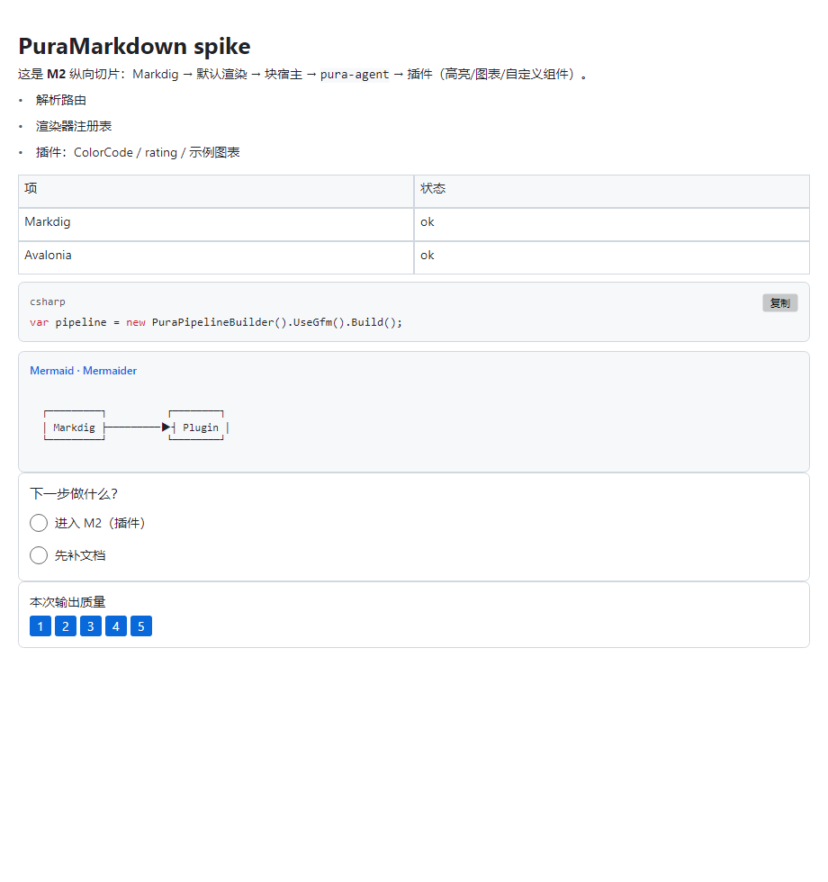
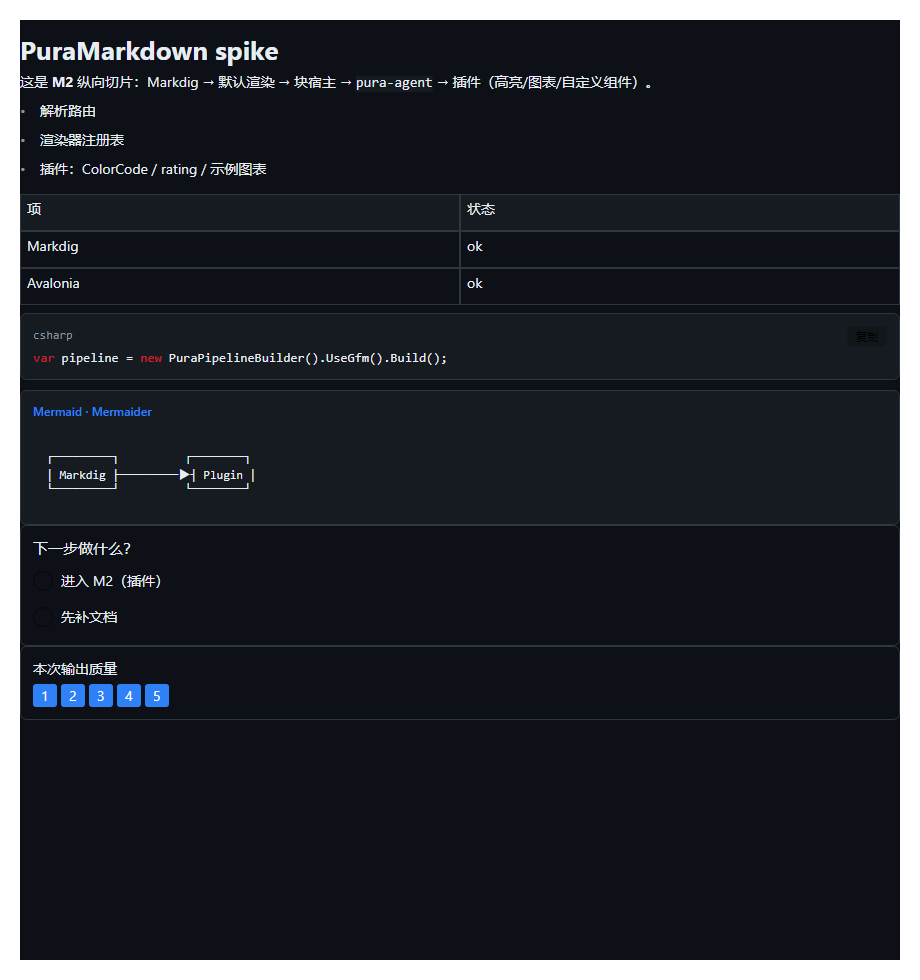

# PuraMarkdown

> 面向 Agent 对话的 **Avalonia 只读 Markdown 控件**：Markdig 解析、Avalonia 原生渲染、Agent 交互组件、流式增量、插件可替换。
>
> 状态：**设计定稿（v0.4）+ M0–M4 已跑通 + 1.0-alpha 就绪**（91 个测试、4 个 NuGet 包、Native AOT/裁剪验证通过、API 文档完整、流式性能修复、CI 就绪）。
> 框架：**.NET 10（net10.0，本机 SDK 10.0.114）** · Avalonia **12.1.5** · Markdig **1.5.1** · JsonSchema.Net **9.6.0** · ColorCode.Core **2.0.15** · Mermaider **0.15.1**。

---

## 它解决什么

Agent 回复不只是"一段 Markdown"：

- **交互**：单选/多选/确认卡片，选择结果事件上报宿主；
- **结构化内容**：工具结果、图表围栏（由插件渲染）；
- **流式**：逐 token 追加，块级增量，不整篇重解析；
- **不可信输入**：畸形/超长/恶意 Markdown 也要可读、安全；
- **可扩展**：代码高亮、图表引擎、自定义组件都可插拔。

## 核心思路（四层）

```
Markdown 文本（全量 or Append 增量）
   │  ① Markdig 解析（CommonMark+GFM, DisableHtml, 精确 Span）
   ▼
混合 AST（标准节点 + PuraAgentBlock + 插件节点）
   │  ② 节点分发：渲染器注册表按优先级匹配
   ▼
③ 渲染执行：IPuraRenderer → Avalonia Control
   │
   ▼
④ 流式会话：稳定边界 + 尾部窗口 + 块级嫁接
```

**没有中间 IR**：Markdig AST 就是文档模型，渲染器直接产出 Avalonia 控件（ADR-0011）。基础渲染器只是注册表中 priority 0 的默认项，可被插件覆盖。

## Agent 扩展语法

主路径是**围栏 + JSON**（对 Markdig 负担最小，降级为普通代码块）：

````markdown
```pura-agent
{
  "type": "choice",
  "version": "1.0",
  "id": "env",
  "question": "选择部署环境",
  "multi": false,
  "options": [
    { "id": "dev",  "label": "开发" },
    { "id": "prod", "label": "生产", "description": "需要审批", "disabled": true }
  ]
}
```
````

核心内置 `choice`（单选/多选）与 `confirm`；其它组件类型由插件注册 `IAgentComponentParser` + `IAgentComponentRenderer` 扩展。容器指令（`:::choice`）不在核心范围，可由插件实现。

## 主要契约

| 契约 | 作用 |
| --- | --- |
| `IPuraRenderer` | `CanRender(node, ctx)` + `Render(node, ctx) → Control`；可选 `IIncrementalPuraRenderer` |
| `IAgentComponentParser` | 按 `type` 解析 `pura-agent` JSON，`JsonSchema.Net` 校验 |
| `IAgentComponentRenderer` | 组件渲染 + 交互事件 |
| `IDiagramRenderer` | 图表围栏（mermaid/pura-chart）→ 控件；无插件回退代码块 |
| `ICodeHighlighter` | 代码 token 化；默认纯等宽 |
| `IPuraPlugin` / `PuraPipelineBuilder` | 插件打包与注册（显式、AOT 友好） |
| `PuraMarkdownView` / `PuraStreamingSession` | 控件与 append-only 流式 API |

## 包结构（规划）

| 包 | 内容 |
| --- | --- |
| `PuraMarkdown` | 控件、契约、解析路由、分发、默认渲染、Agent 组件、流式 |
| `PuraMarkdown.Testing` | 无头渲染宿主、控件树 dump、golden 工具、交互/流式测试驱动 |
| `PuraMarkdown.Highlighting.ColorCode`（可选） | `ICodeHighlighter` 实现 |
| `PuraMarkdown.Diagrams.Mermaid`（可选，M2） | `IDiagramRenderer` 实现 |
| `PuraMarkdown.Diagrams.ScottPlot`（可选，M3） | `pura-chart` 图表插件 |
| `PuraMarkdown.Math.CSharpMath`（可选，1.1） | 公式插件 |
| `samples/PuraMarkdown.Demo` | 演示应用（流式 + 交互 + 主题 + 插件） |

## 使用方式（目标 API）

```csharp
// 启动时构建一次
var pipeline = new PuraPipelineBuilder()
    .UseCommonMark()
    .UseGfm()
    .UseAgentComponents()
    .UseCodeHighlighter(new ColorCodeHighlighter())   // 可选
    .UsePlugin(new MermaidPlugin())                   // 可选
    .Build();

var view = new PuraMarkdownView
{
    Options = new PuraMarkdownOptions { Pipeline = pipeline, Theme = PuraTheme.FluentDark }
};
view.InteractionOccurred += (_, e) => host.HandleChoice(e);

// 历史消息
view.Markdown = message.Text;

// 流式
var session = view.BeginStreaming();
session.Append(delta);
await session.CompleteAsync();
```

## 当前代码（M0 + M1 已跑通）

```bash
dotnet build PuraMarkdown.slnx
dotnet test tests/PuraMarkdown.Tests/PuraMarkdown.Tests.csproj
dotnet run --project samples/PuraMarkdown.Spike/PuraMarkdown.Spike.csproj
```

```
PuraMarkdown.slnx
├─ src/PuraMarkdown/                     # 控件、契约、解析、默认渲染、Agent 组件、流式
├─ src/PuraMarkdown.Testing/             # 无头 dump / golden / 交互探针 / 流式驱动 / 插件一致性
├─ src/PuraMarkdown.Highlighting.ColorCode/  # 官方高亮插件（ColorCode.Core）
├─ src/PuraMarkdown.Diagrams.Mermaid/    # 官方 Mermaid 插件（Mermaider，纯 .NET）
├─ samples/PuraMarkdown.Plugins.Samples/ # 示例插件：rating 组件、示例图表
├─ tests/PuraMarkdown.Tests/             # 无头 Avalonia + 51 个测试 + golden
└─ samples/PuraMarkdown.Spike/           # 离屏渲染示例（打印控件树）
```

已实现：Markdig GFM 管道、渲染器注册表与默认渲染组、块宿主与 `BlockRecord`、`pura-agent` 自定义 BlockParser、choice/confirm（单选即报/多选确认）、Schema 校验与错误路径、链接点击/图片异步/任务列表、主题跟随系统、A11y 名称、只读模式、降级卡、**稳定边界 + 尾部窗口增量流式**、插件校验/回退链、ColorCode 高亮、Mermaid 真实引擎、图表契约与示例插件、自定义组件扩展、键盘交互、播报事件、golden 基线。
细节与偏差见 [M0](docs/08-M0-实现进展.md) / [M1](docs/09-M1-实现进展.md) / [M2](docs/10-M2-实现进展.md) / [M3](docs/11-M3-实现进展.md) 实现进展。

## Demo

**GUI 演示应用**（流式追加、深浅色切换、choice/rating 交互日志、ColorCode/Mermaid 插件）：

```bash
dotnet run --project samples/PuraMarkdown.Demo/PuraMarkdown.Demo.csproj
```

**无头截图**（可复现，不依赖桌面）：

```bash
dotnet run --project samples/PuraMarkdown.Spike -- --screenshot docs/images/demo-light.png
dotnet run --project samples/PuraMarkdown.Spike -- --screenshot docs/images/demo-dark.png --dark
```

浅色主题：



深色主题：



## 文档导航

| 文档 | 内容 | 适合谁 |
| --- | --- | --- |
| [需求方案（用户输入）](docs/PuraMarkdown需求方案.md) | 原始需求与边界定义 | 所有人 |
| [需求对齐与设计复审](docs/00-需求对齐与设计复审.md) | v0.2 → v0.3 的差异、6 项已确认决策、IR/虚拟树/适配层讨论结论 | 决策者 |
| [IR/虚拟树/多平台讨论](docs/07-IR-虚拟渲染树-多平台-讨论与决策.md) | 三项架构取舍的分析、触发条件、回补成本 | 决策者/架构 |
| [需求规格](docs/01-requirements.md) | 65 条 FR、15 条 NFR、M0–M4、决策与暂缓项 | 产品/验收 |
| [架构设计](docs/02-architecture.md) | 四层架构、契约、流式、安全、测试、版本基线 | 实现者 |
| [Agent 扩展语法规范](docs/03-agent-syntax-spec.md) | `pura-agent` 围栏、choice/confirm schema、事件、降级 | 实现者/提示词作者 |
| [插件与渲染契约](docs/04-plugin-and-rendering.md) | 契约定义、注册表/优先级、默认渲染组、示例插件 | 插件作者 |
| [路线图与风险](docs/05-roadmap-and-risks.md) | 版本基线、里程碑、验收、风险、工作量 | 项目管理 |
| [需求→设计对照](docs/06-traceability.md) | FR/NFR 落点与缺口 | 验收 |
| [M0 实现进展](docs/08-M0-实现进展.md) | 已完成范围、验证结果、与设计的偏差、M1 计划 | 实现者/验收 |
| [M1 实现进展](docs/09-M1-实现进展.md) | 自定义解析器、schema 校验、链接/图片/任务列表、主题/A11y、golden 基线 | 实现者/验收 |
| [M2 实现进展](docs/10-M2-实现进展.md) | 插件校验与回退链、ColorCode 高亮插件、图表/rating 示例插件、Testing 工具包 | 实现者/验收 |
| [M3 实现进展](docs/11-M3-实现进展.md) | 稳定边界+尾部窗口增量流式、键盘/播报、真实 Mermaid 引擎、性能烟测 | 实现者/验收 |
| [M4 实现进展](docs/12-M4-实现进展.md) | 1MB/1000 块、安全语料、A11y、示例应用、NuGet 打包、裁剪验证 | 实现者/验收 |
| [1.0 发布准备](docs/13-1.0-发布准备.md) | 基准数据、AOT/裁剪、CI、API 文档现状、发布清单 | 发布负责人 |
| [渲染性能问题分析](docs/14-渲染性能问题分析.md) | 流式卡顿复现数据、根因分级与修复建议 | 架构/性能 |
| [渲染性能修复记录](docs/15-渲染性能修复记录.md) | P0 四项修复内容、前后对比数据与遗留项 | 架构/性能 |
| [多轮长对话性能验证](docs/16-多轮长对话性能验证.md) | 1000 条消息/1.8MB 场景下的耗时、内存与宿主模式建议 | 架构/性能 |
| [消息级虚拟化实现](docs/17-消息级虚拟化实现.md) | ItemsRepeater 虚拟化、1000 条消息 realized 数量与内存对比、宿主建议 | 架构/性能 |
| [块级虚拟化实现](docs/18-块级虚拟化实现.md) | 单条 1MB/1000 块：默认 69.8MB/2.65s → 1.6MB/0.45s | 架构/性能 |
| [Git 版本管理与发布流程](docs/19-Git版本管理与发布流程.md) | 分支、提交规范、版本号、tag 与发布步骤 | 贡献者/发布负责人 |
| [Markdown 完整性检查](docs/20-Markdown完整性检查.md) | 软换行/强制提交等修复记录与剩余 P0/P1/P2 清单 | 架构/质量 |
| [公共 API 与功能扩展建议](docs/21-公共API与功能扩展建议.md) | API 一致性、宿主集成、扩展点与内容语法建议 | 架构/产品 |
| [P1 功能与本地化实现](docs/22-P1功能与本地化实现.md) | 流式生命周期、选择/复制、大纲、事件、主题、中文默认本地化 | 实现者/验收 |
| [示例 Agent 回复](samples/agent-conversation.md) | 新语法样例 | 实现者 |
| [Markdig 调研](docs/research/markdig.md) / [生态调研](docs/research/ecosystem.md) | 技术事实与选型依据 | 实现者 |
| [ADR](docs/adr/) | 决策记录（0011–0016 为 v0.3 新决策） | 所有人 |
| [v0.2 评审报告](docs/review-report.md) | 历史评审（针对旧 IR 架构，结论已不适用） | 追溯 |

## 关键决策（v0.3）

- **无 IR**：Markdig AST 直连 Avalonia 控件；补 `IAstSanitizer` 净化 pass（ADR-0011、ADR-0020）。
- **`pura-agent` 围栏 + JSON** 为扩展语法主路径（ADR-0012）。
- **net10.0** + 最新稳定依赖；使用本机 SDK 10.0.114，不下载新 SDK（ADR-0013）。
- **图表/公式/高亮全部插件化**，核心零引擎依赖；后续给官方默认高亮插件（ADR-0014）。
- **流式 = 块级脏检查 + 尾部窗口 + 视觉树嫁接**（ADR-0015）。
- **核心直接依赖 Avalonia，跨平台交给 Avalonia**（Win/macOS/Linux）；不建渲染适配层、不建虚拟渲染树（ADR-0016、ADR-0021/0022）。
- **不渲染 HTML**（ADR-0009）、**append-only**（ADR-0010）、**交互只产事件**（ADR-0006）。
- **长消息当前用 `StackPanel`**，M3 按实测再优化。

> IR/虚拟渲染树/多平台适配三项的取舍、触发条件与回补成本：见 [讨论文档](docs/07-IR-虚拟渲染树-多平台-讨论与决策.md)。

## 本地开发

```bash
dotnet --version     # 10.0.114
dotnet build
dotnet test
# M0 后：dotnet run --project samples/PuraMarkdown.Demo
```

要求：.NET 10 SDK、Avalonia 12.1.5。

## 许可证

待定（建议 MIT）。第三方依赖须 MIT/BSD/Apache-2.0；详见需求 §8 约束 C-4。


