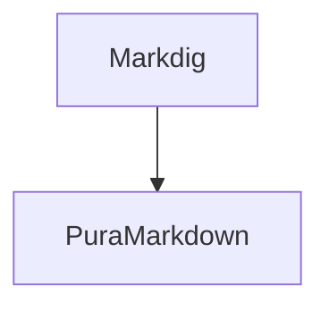

# PuraMarkdown Agent 扩展语法规范（v0.3）

> 版本：`pura/1.0`（草案）
> 状态：规范性文档。实现必须与本文一致；`pura-agent` 围栏为**主路径**，容器指令为可选的插件扩展。
> 变更说明：v0.2 以 `:::` 容器为主路径，v0.3 按 [`PuraMarkdown需求方案.md`](PuraMarkdown需求方案.md) 改为 **围栏 + JSON**（见 ADR-0012）。

---

## 1. 定位与原则

Agent 扩展语法的目标是：**让模型输出的自然文本中，能够夹带"可交互结构化内容"，同时不破坏通用 Markdown 的可读性。**

| 原则 | 含义 | 检验方式 |
| --- | --- | --- |
| P1 可降级 | 在通用 Markdown 渲染器中只是**普通代码块**，源码完整可读 | GitHub/VS Code 预览同一文本 |
| P2 流式安全 | 围栏未闭合、JSON 半截时显示占位而非报错 | 逐字符追加测试 |
| P3 边界明确 | 组件只由围栏边界确定，不依赖缩进/前文 | 注入不同上下文渲染一致 |
| P4 数据与展示分离 | 行为数据用 JSON，展示文案也在 JSON（`question`/`label`） | 无 Markdown-in-JSON 转义问题 |
| P5 无执行 | 语法层不存在脚本/表达式/模板/远程引用 | 语法即约束 |
| P6 对 Markdig 负担最小 | 只需识别一种围栏 Info，不需要嵌套容器解析器 | 实现成本 |

### 1.1 为什么主路径是围栏 + JSON（而不是容器指令）

- Markdig 对 fenced code block 的支持是现成的：自定义 `BlockParser` 只需识别 Info，不必实现嵌套容器；
- JSON Schema 校验、错误定位、降级可以集中在一个独立模块；
- 模型对 ` ``` ` 围栏的格式约束感知更强，生成更稳定；
- 通用渲染器下降级为代码块，信息零丢失。

容器指令（`:::choice … :::`）可读性更好，但需要自定义嵌套解析器；v0.3 将其**降级为插件可选的语法扩展**（见 §8）。

---

## 2. 语法总览

```
┌─ 标准层 ────────────────────────────────────────────────────────┐
│ CommonMark + GFM：段落/标题/强调/列表/任务列表/引用/代码块/表格    │
│ 链接/图片/分隔线/自动链接/删除线/脚注                              │
└──────────────────────────────────────────────────────────────────┘
┌─ Agent 组件层（核心内置）────────────────────────────────────────┐
│ ```pura-agent  → JSON → choice / confirm（内置）                 │
│ ```pura-agent  → JSON → 插件注册的自定义 type                    │
└──────────────────────────────────────────────────────────────────┘
┌─ 图表层（核心只路由，不实现）─────────────────────────────────────┐
│ ```mermaid / ```pura-chart → IDiagramRenderer 插件               │
└──────────────────────────────────────────────────────────────────┘
┌─ 可选语法扩展（插件）────────────────────────────────────────────┐
│ :::choice 容器指令 / 自定义 inline / 自定义围栏 Info             │
└──────────────────────────────────────────────────────────────────┘
```

---

## 3. `pura-agent` 围栏（核心语法）

### 3.1 形态

````markdown
```pura-agent
{
  "type": "choice",
  "version": "1.0",
  "id": "env",
  "question": "选择部署环境",
  "multi": false,
  "options": [
    { "id": "dev",  "label": "开发", "description": "快速迭代" },
    { "id": "prod", "label": "生产", "description": "需要审批", "disabled": true }
  ]
}
```
````

规则：

| 项 | 规则 |
| --- | --- |
| Info | 去除首尾空白后等于 `pura-agent`（大小写不敏感）；不支持 `pura-agent/xxx` 变体 |
| 围栏字符 | ``` 或 ~~~，长度 ≥ 3；闭合围栏长度 ≥ 开启长度 |
| 内容 | **必须是单个 JSON 对象**（`{...}`），不允许顶层数组/标量；必须是严格 JSON（无注释、无尾随逗号） |
| 大小 | 单围栏 ≤ 256 KB；JSON 深度 ≤ 32；超出 → 降级卡 + warning |
| 位置 | 任意顶层块位置；不可嵌套在其它围栏内 |
| 编码 | UTF-8；解析前做 BOM/LF 规范化 |

### 3.2 JSON 公共字段

| 字段 | 类型 | 必需 | 说明 |
| --- | --- | --- | --- |
| `type` | string | 是 | 组件类型，小写字母/数字/连字符，1–64 字符；内置 `choice`、`confirm` |
| `version` | string | 是 | 载荷 schema 版本，如 `"1.0"`；用于迁移/降级判断 |
| `id` | string | 否 | 组件实例 ID，文档内唯一；缺省时由块位置生成（`blk-<n>`） |
| 其它 | — | — | 由各组件 schema 定义；未知字段默认忽略并产生 Info 级诊断（不报错） |

### 3.3 不支持的 type

- 未知 `type` → **通用降级卡**：显示"不支持的组件类型：`type`" + 原始 JSON（可复制），产生 `warning`。
- 插件注册了 `IAgentComponentParser` 后即可支持；无需改核心。

### 3.4 流式不完整

| 状态 | 渲染 |
| --- | --- |
| 围栏未闭合（`IsClosed == false`） | 占位卡："组件加载中…"（可带 spinner；不可交互） |
| 围栏已闭合、JSON 语法错误 | 降级卡：错误位置 + 原因 + 原始 JSON |
| 围栏已闭合、schema 校验失败 | 降级卡：第一条错误（JSON Pointer + 原因）+ 原始 JSON |
| 围栏已闭合、解析成功 | 正式组件控件（交互默认在 `Complete` 后启用） |

> 解析失败**不是异常**：不抛错、不中断消息渲染、不影响后续块。

---

## 4. 内置组件：`choice`（单选 / 多选）

### 4.1 Schema（`type = "choice"`，`version = "1.0"`）

```json
{
  "type": "choice",
  "version": "1.0",
  "id": "deploy-env",
  "question": "选择部署环境",
  "description": "可多选，最多 2 项",
  "multi": false,
  "options": [
    { "id": "dev",  "label": "开发", "description": "快速迭代" },
    { "id": "prod", "label": "生产", "description": "需要审批", "disabled": true }
  ],
  "defaultSelected": ["dev"],
  "min": 1,
  "max": 1,
  "submitLabel": "确认",
  "disabled": false
}
```

| 字段 | 类型 | 默认 | 约束 |
| --- | --- | --- | --- |
| `question` | string | — | 1–500 字符，必需 |
| `description` | string | 无 | ≤ 1000 字符 |
| `multi` | bool | `false` | 单选/多选开关 |
| `options` | array | — | 1–200 项，必需 |
| `options[].id` | string | — | 1–128 字符，数组内唯一，必需 |
| `options[].label` | string | — | 1–500 字符，必需 |
| `options[].description` | string | 无 | ≤ 1000 字符 |
| `options[].disabled` | bool | `false` | 禁用项不可选，但仍展示 |
| `defaultSelected` | string[] | `[]` | 必须是已有 option id；单选最多 1 项 |
| `min` / `max` | int | 0 / 无 | 仅多选生效；`min ≤ max` |
| `submitLabel` | string | `"确认"` | 多选时按钮文案；单选可忽略 |
| `disabled` | bool | `false` | 组件级只读 |

### 4.2 默认渲染

```
┌──────────────────────────────────────────────┐
│ 选择部署环境                                  │
│ 可多选，最多 2 项                              │
│ ○ 开发        快速迭代                        │
│ ● 生产        需要审批（禁用）                 │
│ [ 确认 ]                                      │
└──────────────────────────────────────────────┘
```

- 单选：`RadioButton` 组；多选：`CheckBox` 列表；外层 `Border` + `StackPanel`。
- 标题/描述/选项文案全部来自 JSON，**按文本渲染**（不解析其中的 Markdown/HTML）。
- 只读模式（`InteractionEnabled=false` 或 `disabled=true`）：控件 `IsEnabled=false`；已选项仍可见。
- 组件级错误（如 `defaultSelected` 引用不存在的 id）→ 降级卡 + 第一条错误。

### 4.3 交互与上报

| 场景 | 行为 |
| --- | --- |
| 单选点击某项 | 立即更新选中态；触发 `InteractionOccurred`（`SelectedIds=[id]`） |
| 多选点击"确认" | 校验 `min`/`max`；通过则触发事件（`SelectedIds=[...]`）；不通过则提示并聚焦 |
| 多选点击选项 | 仅更新本地选中态，不触发事件 |
| 重复点击"确认" | 已提交后控件禁用，不重复触发 |
| 只读/禁用 | 不触发事件 |

> 上报时机（Q2 已确认）：单选点击即上报；多选点击"确认"后上报。可由 `PuraStreamingOptions`/组件属性调整；默认如上。

### 4.4 事件载荷（库 → 宿主）

```csharp
view.InteractionOccurred += (_, e) =>
{
    // e.ComponentType = "choice"
    // e.ComponentId   = "deploy-env"
    // e.SelectedIds   = ["prod"]
    // e.Timestamp     = ...
    // 宿主自行决定：发回 Agent / 写入输入框 / 忽略
};
```

- 事件只包含解析后模型中存在的 option id（防伪造）。
- 库**不**提供"建议消息文本"以外的协议（v0.3 保持：可提供 `ToUserMessage()` 扩展方法，返回 `已选择：生产` 之类文本，但传输仍归宿主）。

---

## 5. 内置组件：`confirm`（二选一确认）

```json
{
  "type": "confirm",
  "version": "1.0",
  "id": "delete-repo",
  "question": "确定删除仓库 pura-markdown 吗？",
  "description": "此操作不可撤销。",
  "confirmLabel": "确认删除",
  "cancelLabel": "取消",
  "danger": true
}
```

| 字段 | 类型 | 默认 | 约束 |
| --- | --- | --- | --- |
| `question` | string | — | 必需，≤ 500 字符 |
| `description` | string | 无 | ≤ 2000 字符 |
| `confirmLabel` / `cancelLabel` | string | `确认` / `取消` | ≤ 64 字符 |
| `danger` | bool | `false` | 危险样式（红色按钮） |

- 渲染：`Border` + 标题 + 描述 + 两个按钮；`danger` 影响按钮样式。
- 事件：`SelectedIds = []`，`Confirmed = true/false`；点击后按钮禁用防重复。
- 只读：两个按钮禁用，仍显示文案。

---

## 6. 图表围栏（核心只路由）

```markdown


```pura-chart
{ "type": "bar", "categories": ["1月","2月"], "series": [{ "name": "P95", "data": [120, 98] }] }
```
```

- 核心**不解析**图表内容，也不定义图表 schema。
- 分发规则：对 `FencedCodeBlock`，按注册顺序询问 `IDiagramRenderer.CanRenderDiagram(language, source)`；命中 → 渲染；未命中 → 代码块渲染器（显示原始源码，可复制）。
- `pura-chart` 的 JSON schema 由对应插件包定义（如 `PuraMarkdown.Diagrams.ScottPlot`）；核心只把它当作一个普通 `FencedCodeBlock`。
- 图表渲染失败 → 回退代码块 + warning；绝不阻塞消息渲染。
- 流式：未闭合图表围栏按代码块增量显示（纯文本），闭合后一次性交给插件渲染。

---

## 7. 安全规范（语法层）

| 风险 | 对策 |
| --- | --- |
| 原始 HTML | 解析期 `DisableHtml()`；HTML 按转义文本展示（ADR-0009） |
| 组件文案注入 | `question`/`label`/`description` 一律按**纯文本**渲染，不解析 Markdown/HTML |
| 链接/URL | 由 `IUrlPolicy` 在渲染期过滤；组件 JSON 中不允许携带 URL/资源引用（若插件需要，由插件自行定义并校验） |
| 资源外联 | 核心不联网；图片经 `IImageLoader`；图表插件不得在 `Render` 中同步联网 |
| 资源耗尽 | 围栏/JSON/options/深度/文档大小上限；超限降级 |
| 交互伪造 | 只回传模型中存在的 option id；不接受任意文本 |
| 脚本/表达式 | 语法层不存在；JSON 只做数据校验，不做求值 |

---

## 8. 可选：容器指令（插件扩展）

若宿主/模型偏好容器语法，可通过插件注册自定义 `BlockParser` 支持：

```markdown
:::choice{id="env" multi=false}
- [ ] 开发
- [ ] 生产
:::
```

- 该语法**不在核心保证范围**：由插件实现解析与渲染，核心只提供 `BlockParser`/`IPuraRenderer` 注册点。
- 建议插件复用 `choice` 的组件模型（同样的 JSON schema），只改变"语法外壳"。
- 若同时启用围栏与容器两种写法，文档生成器应只输出其一，避免重复语义。

---

## 9. 版本化与兼容

| 层 | 版本 | 规则 |
| --- | --- | --- |
| 语法规范 | `pura/1.0` | 次版本只新增可选字段/组件；主版本提供迁移器 |
| 组件载荷 | `version: "1.0"` | 组件解析器按版本选择 `IAgentComponentParser`；未知版本 → 降级卡 |
| 渲染契约 | SemVer | 公开接口在 1.x 只增不改 |

- 未知字段：忽略 + Info 诊断（不破坏向前兼容）。
- 已知字段类型错误：该组件降级，不影响其它组件。
- 弃用字段：保留至少一个次版本，渲染时 warning。

---

## 10. 通用渲染器中的降级形态

| Pura 写法 | GitHub/VS Code 中显示 | 是否可接受 |
| --- | --- | --- |
| ` ```pura-agent ` + JSON | 带语言标签的代码块，JSON 高亮 | ✅ 完全可读 |
| ` ```mermaid ` | 代码块（GitHub 原生渲染 Mermaid，属额外收益） | ✅ |
| ` ```pura-chart ` + JSON | 代码块 | ✅ |

> 这是选择围栏主路径的核心理由：**降级零成本**。

---

## 11. 完整示例

````markdown
## 部署检查

我已经检查了仓库，发现两处需要确认。

```pura-agent
{
  "type": "choice",
  "version": "1.0",
  "id": "deploy-env",
  "question": "选择部署环境",
  "multi": false,
  "options": [
    { "id": "dev",  "label": "开发", "description": "快速迭代" },
    { "id": "prod", "label": "生产", "description": "需要审批", "disabled": true }
  ],
  "defaultSelected": ["dev"]
}
```

```pura-agent
{
  "type": "confirm",
  "version": "1.0",
  "id": "apply",
  "question": "确认在 22:00 的变更窗口执行发布？",
  "description": "执行后无法回滚到当前版本。",
  "confirmLabel": "执行发布",
  "cancelLabel": "暂不",
  "danger": true
}
```
````

---

## 12. 与 v0.2 语法的差异

| 项 | v0.2 | v0.3 |
| --- | --- | --- |
| 主路径 | `:::choice{...}` 容器 + 可选 JSON 正文 | ` ```pura-agent ` 围栏 + JSON |
| 组件清单 | 11 个（callout/tool/thinking/diff/…） | 核心 2 个（choice/confirm）+ 插件自定义 |
| 行内组件 | `{{badge}}` 等 | 移除；插件可用自定义 InlineParser |
| 图表 | 核心 `ChartSpec` | 围栏 + `IDiagramRenderer` 插件 |
| 降级形态 | 普通文本 | 代码块（更干净） |

旧语法不保留兼容层；如需迁移，写一个插件把容器指令映射为 `PuraAgentBlock` 即可（M3 可提供示例）。
