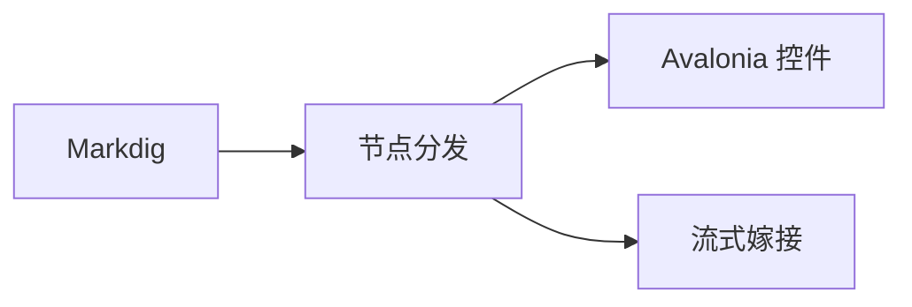

# 示例：一段典型的 Agent 回复（PuraMarkdown v0.3 语法）

> 用途：解析/渲染冒烟测试与 golden 语料。可直接贴到 GitHub 预览：`pura-agent` 围栏会显示为普通 JSON 代码块（降级形态），内容不丢。

---

## 部署前检查

我检查了仓库的发布配置，发现三个问题，建议先处理后发布。

**当前状态**

| 项 | 值 | 结论 |
| --- | --- | --- |
| 目标框架 | net10.0 | ✅ |
| Markdig | 1.5.1 | ✅ |
| Avalonia | 12.1.5 | ✅ |
| CI 缓存 | 未启用 | ⚠️ 建议启用 |

**相关代码**

```csharp
var pipeline = new PuraPipelineBuilder()
    .UseCommonMark()
    .UseGfm()
    .UseAgentComponents()
    .Build();
```



## 需要你确认

```pura-agent
{
  "type": "choice",
  "version": "1.0",
  "id": "release-plan",
  "question": "选择本次发布策略（可多选，最多 2 项）",
  "description": "选择后我会继续执行发布流程。",
  "multi": true,
  "min": 1,
  "max": 2,
  "options": [
    { "id": "blue-green", "label": "蓝绿部署", "description": "零停机，成本翻倍" },
    { "id": "canary",     "label": "金丝雀发布", "description": "渐进放量，需要监控" },
    { "id": "rolling",    "label": "滚动更新", "description": "资源占用低" },
    { "id": "hotfix",     "label": "仅热修复", "description": "当前环境未启用", "disabled": true }
  ],
  "defaultSelected": ["canary"],
  "submitLabel": "确认策略"
}
```

```pura-agent
{
  "type": "confirm",
  "version": "1.0",
  "id": "apply-release",
  "question": "确认在 22:00 的变更窗口执行发布？",
  "description": "执行后将无法回滚到当前版本。",
  "confirmLabel": "执行发布",
  "cancelLabel": "暂不发布",
  "danger": true
}
```

## 说明

- 以上两个 `pura-agent` 围栏由 PuraMarkdown 渲染为交互卡片；通用 Markdown 渲染器只显示 JSON 代码块。
- 用户选择后，宿主收到 `InteractionOccurred` 事件，自行决定是否回传 Agent。
- 若需要图表，`mermaid`/`pura-chart` 围栏由 `IDiagramRenderer` 插件渲染；未安装插件时回退为代码块。
